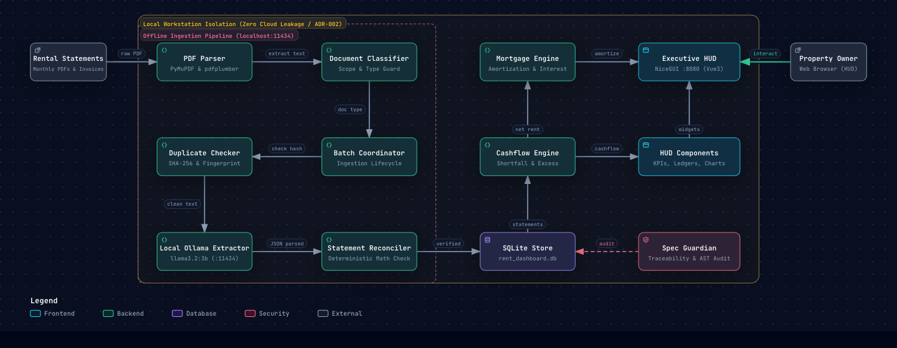

# Rent Management Dashboard

A local-first, privacy-focused executive property management dashboard and document ingestion pipeline built with **Spec-Driven Development (SDD)** and **deterministic financial mathematics**.

Designed for UK property owners and landlords to track monthly rental cashflow, mortgage amortization, contractor expenses, compliance certifications, and maintenance issues without leaking private financial records to cloud services.

[](pyproject.toml)
[-emerald.svg)](src/ui/app.py)
[-purple.svg)](ADR.md)
[](src/domain/cashflow.py)
[-teal.svg)](specs/README.md)
[](LICENSE)

---

## System Architecture & Pipeline

[](Doc/rent-management-system.html)

> 🌟 **Interactive Architecture Visualization**:
> Click the diagram above or open [Doc/rent-management-system.html](Doc/rent-management-system.html) to launch the standalone Archify visualization with responsive theme switching, detailed component inspection, and Semantic Passport (`⚡ Open in IDE` direct code jumping).

The system is designed with two strict architectural boundaries: **Local Workstation Isolation** (zero cloud egress) and a dedicated **Offline Ingestion Pipeline** running local LLM extraction.

### Diagram-to-Code Traceability Table

| Architecture Component | Layer | Code Source | Key Functionality |
| :--- | :--- | :--- | :--- |
| **PDF Parser** | Ingestion | [`src/ingestion/pdf_reader.py`](src/ingestion/pdf_reader.py) | Dual-engine text extraction (PyMuPDF & pdfplumber) with layout degradation fallback |
| **Document Classifier** | Ingestion | [`src/ingestion/classifier.py`](src/ingestion/classifier.py) | Scope guard identifying statements, contractor invoices, and statutory certificates (`INGEST-006`) |
| **Duplicate Checker** | Ingestion | [`src/ingestion/duplicate_checker.py`](src/ingestion/duplicate_checker.py) | Two-tier deduplication via SHA-256 file hashes and semantic statement metadata (`INGEST-002`) |
| **Batch Coordinator** | Ingestion | [`src/ingestion/batch.py`](src/ingestion/batch.py) | End-to-end directory scanner and processing coordinator (`INGEST-004`, `INGEST-005`) |
| **Local Ollama LLM** | Ingestion | [`src/ingestion/extractor.py`](src/ingestion/extractor.py) | Zero cloud egress structured JSON extraction (`localhost:11434`, `llama3.2:3b`) (`INGEST-001`) |
| **Statement Reconciler** | Ingestion | [`src/ingestion/reconciler.py`](src/ingestion/reconciler.py) | Deterministic three-way check: `gross_rent - total_expenditure == net_payout` (`INGEST-003`) |
| **SQLite Store** | Persistence | [`src/storage/database.py`](src/storage/database.py) | Local SQLite persistence (`data/rent_dashboard.db`) with WAL journaling mode |
| **Cashflow Engine** | Domain | [`src/domain/cashflow.py`](src/domain/cashflow.py) | Exact Decimal shortfall and surplus calculations (`CASH-001`) |
| **Mortgage Engine** | Domain | [`src/domain/mortgage.py`](src/domain/mortgage.py) | Principal balance amortization, fixed deal countdowns, and Consent to Let tracking (`MORT-001`, `MORT-002`) |
| **HUD Components** | Frontend | [`src/ui/components.py`](src/ui/components.py) | In-place reactive cards, statement tables, cashflow charts, and compliance alert pills (`UI-001`, `UI-002`) |
| **Executive HUD** | Frontend | [`src/ui/app.py`](src/ui/app.py) | NiceGUI single-page dashboard with 4 executive themes (`UI-003`) |
| **Spec Guardian** | Quality | [`tools/guardian/auditor.py`](tools/guardian/auditor.py) | Two-way AST verification, EARS block hashing, and 6-Gate release gatekeeping |

---

## Core Directives & Architectural Decisions

1. **Absolute Data Privacy ([ADR-002](ADR.md#adr-002-local-first-privacy-architecture-via-ollama-and-sqlite))**: All document extraction runs locally using Ollama (`localhost:11434`, default: `llama3.2:3b`). Financial statements, invoices, and tenant details are strictly stored in local SQLite (`data/rent_dashboard.db`). Zero outbound network calls are made.
2. **Deterministic Mathematics ([ADR-003](ADR.md#adr-003-deterministic-financial-mathematics-via-python-decimal))**: LLMs are strictly confined to unstructured document parsing. All calculations (out-of-pocket shortfall, net landlord cashflow, mortgage balance tracking, and tax summaries) are computed in Python using `decimal.Decimal` with penny precision.
3. **Spec-Driven Governance ([ADR-001](ADR.md#adr-001-spec-driven-development-sdd-with-ears--sha-256-block-hashing))**: All features and tests trace directly to formal EARS specifications in `specs/`. Spec hashes and AST coverage are verified with the project-local Spec Guardian (`tools.guardian`).
4. **Calm Executive HUD ([ADR-004](ADR.md#adr-004-python-centric-executive-ui-nicegui-with-multi-theme-support))**: A high-contrast, distraction-free single-property interface built with NiceGUI, featuring in-place reactive component updates and 4 built-in visual themes.
5. **Project-Wide Configuration & Loan Ledger ([ADR-005](ADR.md#adr-005-project-wide-configuration--monthly-loan-balance-ledger))**: Centralized baseline settings in `config.toml` (from `config.example.toml`) combined with SQLite historical loan balance progression.

---

## Quickstart

### Prerequisites
- Python 3.11+
- [uv](https://github.com/astral-sh/uv) package manager
- (Optional, for automated PDF extraction) [Ollama](https://ollama.ai) installed and running locally with `llama3.2:3b`:
  ```bash
  ollama run llama3.2:3b
  ```

### Installation
```bash
# Clone the repository
git clone https://github.com/<your-username>/RentManagementDashboard.git
cd RentManagementDashboard

# Sync virtual environment and dependencies via uv
uv sync

# Create your local configuration from template
cp config.example.toml config.toml
```

### Launch the Executive Dashboard
```bash
uv run python -m tools.dashboard
```
Open your browser at `http://localhost:8080` to access the Executive HUD.

---

## Document Ingestion & Extraction CLI

Extract rental statements and contractor invoices offline using local PDF text extraction and Ollama:

```bash
# Ingest a single PDF file (auto-detects statement vs invoice):
uv run python -m tools.ingest "<path_to_pdf>"

# Examples:
uv run python -m tools.ingest "data/samples/sample_statement.pdf"
uv run python -m tools.ingest "data/samples/contractor_invoice.pdf"

# Ingest an entire directory of documents in batch mode:
uv run python -m tools.ingest "path/to/documents_folder"
```

### Ingestion Features:
- **Two-Tier Duplicate Detection**: Prevents duplicate ingestion using SHA-256 byte hashes and semantic invoice/statement metadata fingerprints.
- **Scope & Relevance Guard (`INGEST-006`)**: Identifies letting statements, contractor invoices, and statutory compliance certificates (EICR, Gas Safety, EPC, Legionella).
- **Deterministic Math Cross-Check (`INGEST-003`)**: Verifies that `gross_rent - total_expenditure == net_payout` to the penny before saving.
- **Degradation Resilience (`INGEST-007`)**: Automatically falls back between PyMuPDF and pdfplumber when layout degradation is detected.

### CLI Flags:
- `--type [auto|statement|invoice]`: Explicitly specify document type (default: `auto`).
- `--model <MODEL_NAME>`: Specify local Ollama model (default: from `config.toml`, e.g., `llama3.2:3b`).
- `--balance <AMOUNT>`: Optional remaining mortgage principal to record alongside statement.
- `--dry-run`: Parse and display extracted figures without modifying the database.
- `--overwrite`: Explicitly update an existing statement and its expenditures for the month.

---

## Cashflow & Mortgage Calculations CLI

Calculate monthly landlord cashflow, out-of-pocket mortgage shortfall, and loan amortization:

```bash
# Calculate from configuration settings and statement PDF:
uv run python -m tools.cashflow --statement "path/to/statement.pdf"

# Calculate from manual net rent payout (loads mortgage terms from config.toml):
uv run python -m tools.cashflow --net-rent 571.90

# Optional explicit parameter overrides:
uv run python -m tools.cashflow --net-rent 571.90 --mortgage-debit 1997.00 --balance 68735.81 --statement-date 16-10-2026
```

*Notes on Domain Logic:*
- Baseline mortgage parameters (direct debit, interest rate, deal expiry date, initial principal) are loaded from `config.toml`.
- Dates strictly follow the `DD-MM-YYYY` standard.
- Property equity is explicitly excluded from calculations and displays to maintain a conservative, debt-reduction focus.

---

## Spec Guardian & Quality Verification

Spec Guardian (`tools.guardian`) acts as the automated architecture and requirement gatekeeper, executing **two-way verification using cryptographic hashes**:

- **Forward Check (Normalized SHA-256 Hashing)**: Every EARS requirement block (`## [REQ-ID]:`) in `specs/` is normalized and cryptographically fingerprinted via SHA-256. Any modification to requirement text, business logic, or acceptance criteria automatically alters the hash, immediately flagging mapped implementations and tests as unverified until audited.
- **Reverse Check (AST Static Analysis)**: Scans all public classes, methods, and functions across `src/` to verify that 100% of codebase symbols explicitly map back to an approved requirement (`# [spec: REQ-ID]`), mathematically preventing undocumented features and feature-creep.
- **Anti-Mirage Test Verification**: Tests in `tests/` are bound to exact acceptance criteria (`# [verifies: REQ-ID/AC-ID]`), enforcing strict 1-test-to-1-AC cardinality, call-graph symbol assertions, and deterministic numeric checks before release tagging.

### 1. Spec Guardian Traceability Audit
Verify that all code implementations and tests match their EARS specifications with zero hash drift:
```bash
# Focused audit (active/implemented specifications)
uv run python -m tools.guardian audit

# Full roadmap audit (includes all [PLANNED] future specifications)
uv run python -m tools.guardian audit --all

# Pre-commit strict audit (fails if any criterion lacks tests or has spec drift)
uv run python -m tools.guardian audit --strict
```

### 2. Automated Test Suite
Run the full test suite verifying acceptance criteria:
```bash
uv run pytest
```

### 3. Code Hygiene & Formatting
Enforce formatting and lint rules via Ruff:
```bash
uv run ruff check --fix .
uv run ruff format .
```

---

## Release Management & Governance

Releases follow Semantic Versioning (`MAJOR.MINOR.PATCH`) governed by an automated **6-Gate Release Pipeline** ([tools/release_manager.py](tools/release_manager.py)):

### Governance Principles
1. **Human-in-the-Loop Approval**: Always obtain explicit confirmation before creating any **MAJOR** or **MINOR** version.
2. **Four-Pillar Project Review**: Every release candidate must pass automated and manual checks against project ADRs ([ADR.md](ADR.md)) and the project review skill.
   - **Pillar 1 (Privacy & Local-Only)**: Zero external network endpoints; sensitive documents (`Resources/*.pdf`), live configuration (`config.toml`), and database files (`data/*.db`) excluded from Git.
   - **Pillar 2 (Deterministic Mathematics)**: All arithmetic uses Python `Decimal` with penny precision; zero `float` conversions in domain models; LLMs strictly confined to document parsing.
   - **Pillar 3 (Spec Traceability & Config Hygiene)**: 100% of code/tests bound to EARS specifications; zero hardcoded fallback figures; zero property equity tracking or display.
   - **Pillar 4 (Engineering Health & Anti-Mirage Tests)**: Deterministic assertions with exact numeric anchors; test isolation using temporary fixtures or `config.example.toml`; clean relative paths across all markdown documentation.
3. **Spec Guardian Gatekeeper**: 100% of active acceptance criteria must be verified with zero spec hash drift before release tagging.

### The 6-Gate Release Pipeline
When `release_manager create` is invoked, the following gates execute sequentially:
1. **[Gate 1/6] Git Working Tree Check**: Verifies that no uncommitted or dirty code files exist.
2. **[Gate 2/6] Four-Pillar Architectural & Code Review Audit**: Runs automated AST and regex scanners across privacy, math, path cleanliness, and configuration rules, verifying 100% compliance with project ADRs.
3. **[Gate 3/6] Spec Guardian Strict Audit**: Runs `tools.guardian audit --strict` ensuring 100% test coverage and zero spec drift.
4. **[Gate 4/6] Test Suite**: Executes the full test suite via `uv run pytest`.
5. **[Gate 5/6] Code Hygiene**: Enforces formatting and lint checks via `uv run ruff check --fix .` and `ruff format .`.
6. **[Gate 6/6] Version Bump & Annotated Git Tag**: Updates `pyproject.toml`, commits the release manifest changes, and generates an annotated Git tag `v<VERSION>`.

### Release CLI Commands
```bash
# List all release tags with summaries:
uv run python -m tools.release_manager list

# Create a new release (executes all 6 quality gates automatically):
uv run python -m tools.release_manager create <VERSION> -m "<SUMMARY>"
```

For the complete version roadmap and historical release notes, see [release.md](release.md).

---

## License

This project is licensed under the MIT License - see the [LICENSE](LICENSE) file for details.
